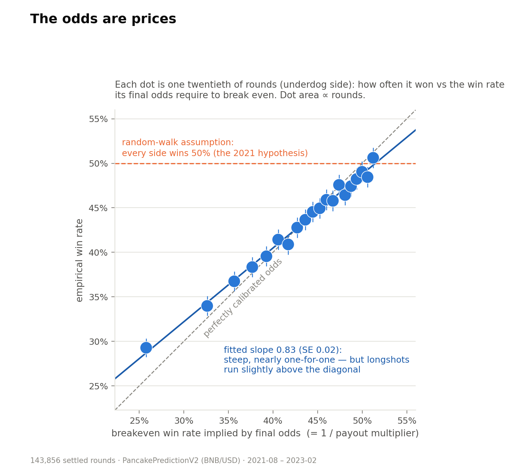
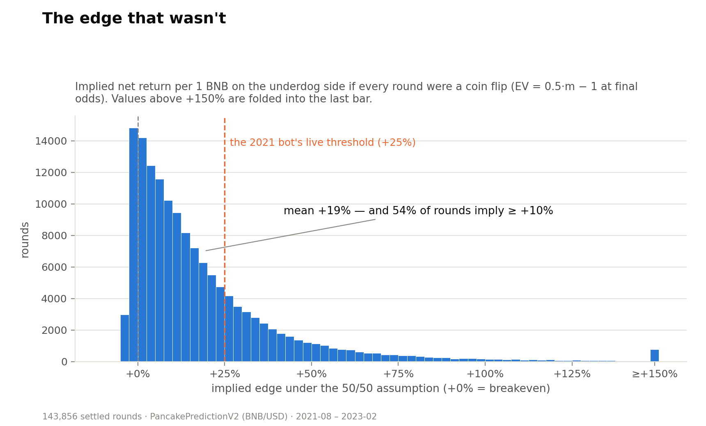
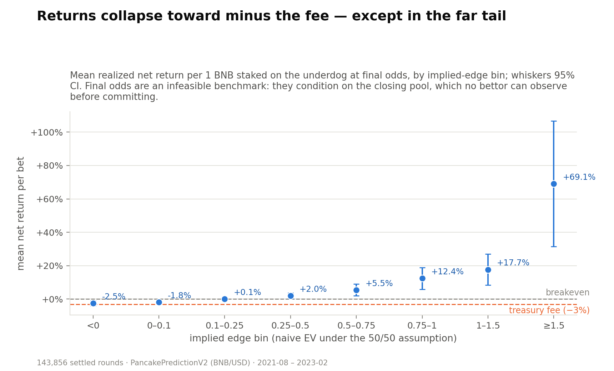
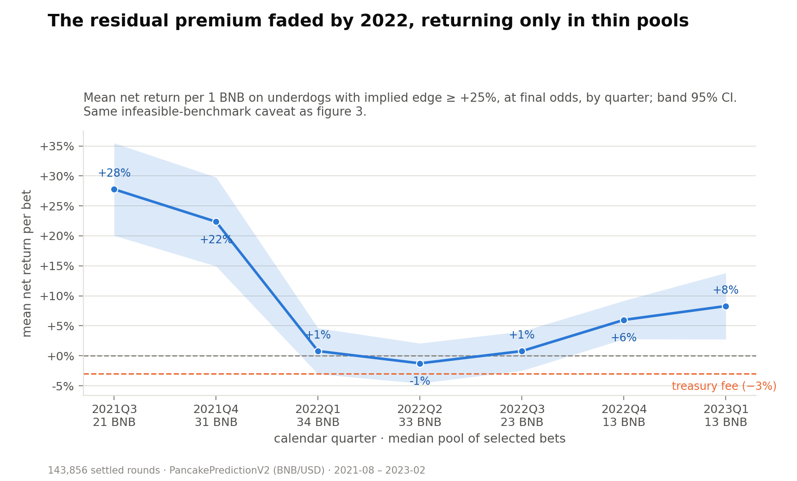

# The Arbitrage That Wasn't: 144,000 Rounds of a Five-Minute Crypto Betting Market

*A 2021 betting bot, the full on-chain round history, and a reproducible post-mortem of a +19% paper edge that nets out to roughly minus the fee.*

[](https://github.com/xcnecon/PancakeSwap-Arbitrage-Bot/actions/workflows/ci.yml)


Every number and figure below is regenerated by `python -m research.pipeline`; the dataset invariants are asserted by tests, and CI re-runs both on every push. The repo keeps its 2021 name — the study below explains why "arbitrage" earned its scare quotes.

## TL;DR

PancakeSwap Prediction is a parimutuel bet on five-minute BNB/USD moves: back Bull or Bear, winners split the losers' pool minus a 3% fee. In 2021 I noticed the two sides' payouts often diverged wildly and built a bot on a simple hypothesis: if a five-minute crypto move is a coin flip, betting the thin side whenever its implied edge cleared +25% should be free money — the average round quoted a +19% edge under that assumption. Across 143,856 settled rounds, the assumption fails in the most instructive way possible: the more a side pays, the less often it wins (43.3% for underdogs overall, down to 23% in the extreme tail), tracking the payout-implied breakeven rate almost one-for-one. What survives is a small *reverse* favorite–longshot bias — underdogs at final odds returned +5.5% per bet above the +25% threshold — but it lived in thin pools, faded as the market deepened, could not absorb even 1 BNB of size, and was never observable at bet time anyway. I ran the strategy live in 2021; this repo contains the bot, the data, and the pipeline that measures why the paper edge was a mirage.



## Reproduce everything

```bash
pip install -r requirements.txt
python -m research.pipeline   # rebuilds results/stats.json, results/edge_bins.md, figures/
pytest                        # strategy math, dataset invariants, pipeline smoke test
```

The pipeline is deterministic, runs in about half a minute on a laptop, and writes every statistic cited here to [`results/stats.json`](results/stats.json) in machine-readable form. To watch the bot reason about live rounds without risking anything:

```bash
python -m bot.run             # dry-run by default: logs would-be bets, signs nothing
```

## 1. The market

PancakeSwap Prediction (the [`PancakePredictionV2`](https://bscscan.com/address/0x18B2A687610328590Bc8F2e5fEdDe3b582A49cdA) contract on BNB Chain) runs staggered five-minute rounds around a Chainlink BNB/USD feed:

```
start ──────── betting open ──────── lock ──────── price runs ──────── close
  |     bet Bull or Bear (~5 min)     |    oracle price recorded (~5 min)  |
  └── round n's betting window overlaps round n−1's live window ──────────┘
```

Bull wins if the close price exceeds the lock price, Bear if it is lower; on an exact tie the house keeps the whole pool (387 rounds, 0.27% of the sample). A winning 1 BNB stake pays the parimutuel multiplier

```
m = (1 − fee) · totalAmount / winnerPool
```

stake included. The treasury fee, measured from the data rather than assumed, is 3.00% in every settled round with a winning side. Median pool: 23.0 BNB per round; median round length: 309 seconds.

## 2. The naive trade

If every round were a fair coin flip, the expected net return of one unit on side *S* would be `EV = 0.5·m − 1`, which is positive whenever *S* holds less than 48.5% of the pool. Pools are lopsided often: the average round's underdog quoted a naive edge of +19%, and 54% of rounds quoted at least +10%.



This is exactly the signal the 2021 bot traded: watch the pools, and in the final ten seconds before lock fire a bet whenever the naive EV cleared +25%. The rest of this document is about why that number did not survive contact with the data — the more the pool "pays" you to take a side, the less likely that side is to win.

## 3. Data

`data/rounds.csv.gz` holds all 144,000 rounds served by the contract's public `rounds()` view between epoch 100 (2021-08-26) and epoch 144,099 (2023-02-06). Filters: 119 voided rounds (`oracleCalled = FALSE`) and 25 rounds with an empty side are excluded, leaving 143,856. Amounts were exported in scientific notation (~6 significant digits — exact enough for payout ratios, not for wei-level accounting); prices are Chainlink integers ×1e8; timestamps UTC. The sample includes 40 service gaps longer than an hour (chain halts and contract pauses; the longest, 58 hours, in November 2021). Column dictionary and caveats: [`data/README.md`](data/README.md).

Two artifacts of the 2021 live run survive in [`assets/legacy/`](assets/legacy/): the bot's ex-post EV distribution and the first win-rate regression, kept as provenance for §6.

## 4. Result 1 — the odds are prices

Sort each round's underdog into bins of implied edge and compare three numbers per bin: the win rate its final odds *require* to break even, the win rate it *achieved*, and the realized return per bet (auto-generated at [`results/edge_bins.md`](results/edge_bins.md)):

| Implied edge (naive EV) | Rounds | Mean payout | Breakeven win rate | Actual win rate | Realized return/bet | t |
|---|---|---|---|---|---|---|
| <0 | 17,803 | 1.97× | 50.8% | 49.5% | −2.46% | −3.3 |
| 0–0.1 | 48,479 | 2.09× | 47.8% | 47.0% | −1.78% | −3.7 |
| 0.1–0.25 | 41,362 | 2.33× | 43.0% | 43.0% | +0.05% | +0.1 |
| 0.25–0.5 | 24,138 | 2.69× | 37.2% | 37.9% | +2.02% | +2.4 |
| 0.5–0.75 | 7,077 | 3.21× | 31.3% | 33.0% | +5.49% | +3.1 |
| 0.75–1 | 2,591 | 3.71× | 27.0% | 30.4% | +12.44% | +3.7 |
| 1–1.5 | 1,672 | 4.38× | 22.9% | 27.0% | +17.72% | +3.7 |
| ≥1.5 | 734 | 6.53× | 16.6% | 23.2% | +69.12% | +3.6 |
| **all** | 143,856 | 2.38× | — | 43.3% | +0.50% | — |

*Realized returns are computed at final odds — an infeasible benchmark: they condition on the closing pool, which no bettor can observe before committing.*

The 50% column the 2021 hypothesis predicted does not exist. Win rates fall from 49.5% to 23.2% in near-lockstep with the breakeven rate — the calibration figure above puts the fitted slope at 0.83 (SE 0.02), and a logit of underdog wins on implied edge rejects the random walk at any conventional level (coefficient −0.84, z = −19.5; heteroskedasticity-robust standard errors here and throughout). The pool ratio at lock is a price, and even in a five-minute crypto casino, prices aggregate information.

## 5. Result 2 — what's left is small, reversed, and decaying

A slope below one means the crowd slightly *under*-prices extreme underdogs — the reverse of the racetrack favorite–longshot bias. At final odds, backing every underdog above the bot's +25% threshold returned +5.53% per bet (t = 6.6, n = 36,212); above +50%, +12.5% (t = 6.8). Two things stop this from being an investment thesis.



First, "final odds" is an infeasible benchmark — it conditions on the closing pool, which no bettor can observe before committing. Second, the premium did not survive the market's first year: +28% per bet in 2021Q3 fades to −1% by 2022Q2 as the market matured and the median pool behind those bets deepened from 21 toward 34 BNB, and it re-emerges (+6% in 2022Q4, +8% in the partial 2023Q1) only once the dying market had thinned back to 13 BNB pools. Whether arbitrageurs competed it away or deeper pools simply diluted it, the data cannot say — what they show is that the mispricing never persisted where real money could follow it.



The cross-section agrees, if noisily: within the τ ≥ 0.25 sample, returns fall from +11.2% per bet in the smallest-pool quartile (median 11 BNB) to +4.0% in the largest (43 BNB), non-monotonically in between (+6.2%, +0.7%).

## 6. Result 3 — why you couldn't eat it

An itemized account of the gap between the quoted edge and a live P&L, at the bot's own threshold (τ ≥ 0.25):

| Step | Edge per bet (0.1 BNB stake where size matters) |
|---|---|
| Implied by the 50/50 assumption at final odds (mean over selected bets — a proxy for the bet-time quote, ~10s of flow away) | **+51%** |
| … after the win-rate correction (win 35.6%, not 50%), at final odds | **+5.5%** |
| … after your own 0.1 BNB dilutes the thin pool you're betting into | **+4.0%** |
| … after gas (~0.001 BNB per bet + amortized claim at 2021's 5 gwei; estimate) | **≈ +3%** |
| … after the last-seconds flow you cannot see (you commit ~10s before lock) | **≈ 0 to −3%** |
| At 1 BNB of size, dilution alone | **−4.6%** |

The last row before size is the one the on-chain snapshot cannot decompose — final pools only — but the 2021 live run recorded it directly: the ex-post EV measured after lock sat systematically below the EV quoted at bet time ([legacy figure](assets/legacy/2021_expost_ev_distribution.png), mass well below the ex-ante threshold). Informed money arrives last, and in a parimutuel market the last money sets your odds. The live strategy netted out around minus the fee: an efficient-markets result in the venue where you would least expect one.

## 7. The apparatus: the bot

The 2021 design, preserved in spirit: poll the contract, and in the last ten seconds before lock compute each side's EV from the live pools; fire `betBull`/`betBear` when the threshold clears; re-read the pools ~15 seconds after lock to log the ex-post EV (the piece that later falsified the hypothesis); batch `claim()` calls to amortize gas. The rewrite modernizes the engineering while keeping that logic:

- `bot/strategy.py` — the decision math as pure functions, including the exact fee treatment (`0.5·(1−fee)·T/S − 1`; the 2021 code's `T/S/2 − 1.03` treated the fee as additive, overstating EV precisely on the imbalanced rounds it selected) and own-stake dilution. Fully unit-tested, no network imports.
- `bot/client.py` — a thin web3 v7 client: nonce from the pending pool, gas price from the node (BNB Chain's floor is 0.1 gwei since 2025, not 2021's hardcoded 5), claims discovered via `getUserRounds` instead of one call per historical epoch.
- `bot/run.py` — sleeps until each round's betting window instead of busy-polling the RPC, retries with capped exponential backoff, and defaults to `DRY_RUN=true`: it signs and sends nothing until you pass `--live`.
- `bot/config.py` + `.env.example` — credentials live in an untracked `.env`, never in source. Use a burner wallet if you go live.

Do not fund this bot — the central finding of this repository is that it does not make money. It works; the strategy doesn't. Run it dry to watch it lose hypothetically, or run `python -m research.pipeline` to see why it must. (The contract itself is still live: epoch ~496,000 as of July 2026.)

## 8. Interpretation, and a question answered

Why could anyone predict BNB over five minutes? The resolution is that nobody does. The final pool share predicts the round's direction strongly (logit coefficient 3.5, z = 63), and it subsumes momentum: last-round return predicts direction on its own (z = 11.5), but conditional on the pool share its sign flips and shrinks (z = −2.1). Bettors chase momentum (corr(share, r₋₁) = 0.22), some of the flow is informed, and the informed part arrives late — the adverse-selection logic of parimutuel models with late informed bettors (Ottaviani & Sørensen, 2009), which accommodates either sign of the resulting bias. The result is a market where odds track outcomes at slope 0.83: not perfectly efficient — extreme longshots stayed cheap in the thin early months, the *reverse* of the racetrack favorite–longshot bias catalogued by Thaler & Ziemba (1988) and revisited by Snowberg & Wolfers (2010) — but efficient enough that fees, impact, and timing ate the residual for any real bettor. A five-minute casino on a chain full of bots is still a market.

## 9. Limitations and next steps

- The dataset snapshots **final pools only**. The late-flow mechanism in §6 is inferred from the 2021 live logs and the decay pattern, not decomposed bet-by-bet on-chain. Scraping `BetBull`/`BetBear` event logs would timestamp the flow inside each window and identify *when* the smart money arrives — the natural next study.
- All backtests ignore execution latency; returns are per-bet means, not a funded equity curve. The headline t-stats treat rounds as independent, but the conclusion does not lean on that: clustering by calendar day leaves the τ ≥ 0.25 t-stat at 5.9 across 526 days (`backtest_final_odds` in `results/stats.json`).
- Single asset (BNB/USD), single venue, single fee regime, Aug 2021 – Feb 2023. The residual-premium estimates are tail-sensitive: the ≥1.5 bin holds 734 rounds with 6.5× mean payouts, so a handful of outcomes moves it by percentage points. None of these caveats can resurrect the 50/50 assumption, which fails at z = −19.5 across the full sample.
- The 5-minute return autocorrelation (+0.08, t = 31) partly reflects the oracle's update mechanics; I make no market-microstructure claims about BNB itself.

## 10. Repo map, license, citation

```
├── data/               # rounds.csv.gz (144k rounds) + column dictionary
├── research/           # loaders → metrics → figures → pipeline (one command)
├── results/            # stats.json + edge_bins.md, regenerated by the pipeline
├── figures/            # the four figures above, regenerated by the pipeline
├── bot/                # strategy (pure math) / client (web3) / run (CLI) / config
├── tests/              # strategy math, dataset invariants, dry-run safety, smoke
└── assets/legacy/      # the 2021 live-run figures, kept as provenance
```

The original 2021 `main.py` and `keys.py` are preserved in git history. MIT license. If you use the dataset, cite via [`CITATION.cff`](CITATION.cff).

Built live on BNB Chain in 2021; revisited as a study in 2026.
